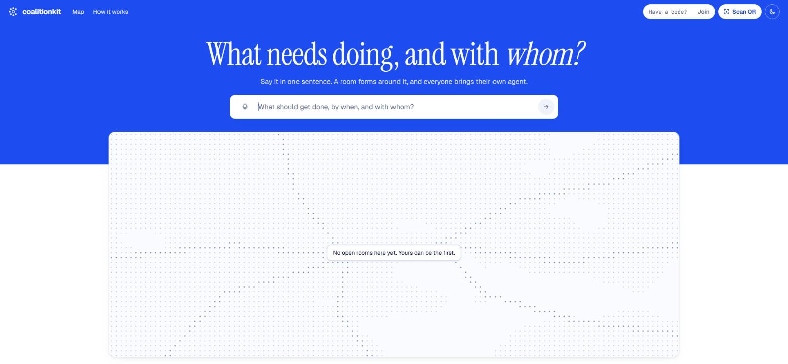
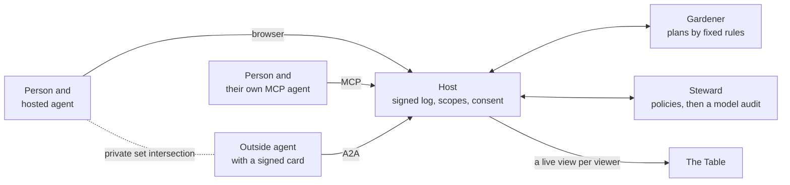

# CoalitionKit

**An open kit for groups whose AI agents work toward one goal together, with every decision signed by a person.**

<a href="https://github.com/HeshamFS/coalitionkit/actions/workflows/ci.yml"></a>
<a href="LICENSE"></a>




You say what needs doing in one sentence. Everyone joins with their own agent, from any vendor. The agents ask their people a few private questions, make offers and compare free times without showing them. The room lays out plans, and nothing binds anyone until that person signs it with a press and hold.

## Try it

You need [uv](https://docs.astral.sh/uv/) and Node 22 for the web room. To compare free times privately, also install libsodium (`apt install libsodium23` on Debian or Ubuntu, `brew install libsodium` on macOS).

```sh
git clone https://github.com/HeshamFS/coalitionkit
cd coalitionkit
uv run coalitionkit up
```

The first run builds the web room, which takes a minute or two. Then open the address it prints, and say what needs doing in one sentence.

No model key is needed: without one, the room runs on fixed rules and says so. Set `COALITIONKIT_META_API_KEY` for real models. In our test runs, a room of two or three people cost about $0.10 to $0.25 in model calls. See [Your first room](docs/get-started/first-room.md).

## What is in it

| | |
|---|---|
| **Any agent can join** | Over [MCP](docs/guides/mcp-agents.md) from a tool you already use, or over [A2A](docs/guides/a2a-business-agent.md) with its own signed card. There are [example members on Google ADK and LangGraph](docs/guides/adk-member.md) |
| **People decide** | An agent can never commit you. [Consent](docs/concepts/consent.md) is signed with your own key, on a screen no model can draw |
| **Private by design** | Your [vault](docs/concepts/vault-and-psi.md) answers narrow questions only, and free times are compared with private set intersection |
| **An independent checker** | The [Steward](docs/concepts/steward.md) runs fixed policies, then a model audit on a different model, before a message reaches anyone |
| **A record you can check** | One [signed, hash-linked log](docs/concepts/signed-chain-and-receipts.md) per room, with receipts, which [your own browser can verify](docs/concepts/browser-verification.md) |
| **Screens from a closed catalog** | Models compose from [201 checked components](docs/reference/catalog/index.md), never HTML, and [every number points at a real event](docs/concepts/generative-ui.md) |
| **Fair plans from fixed rules** | [Plans](docs/concepts/plans-and-fairness.md) come from code. The model only explains them |
| **Plans can change** | Say what happened, and a [ripple](docs/concepts/ripple-and-change.md) reopens only the tasks it touches |
| **More than a browser** | People can also take part over [WhatsApp](docs/guides/whatsapp.md) or a [glasses view](docs/guides/glasses.md) |
| **Teach it your field** | A [Discipline Pack](docs/guides/packs/index.md) is a folder of data: words, roles, schemas, policies and tests. It cannot run code in the host |

## How it fits together



The host orders one log per room and gives each viewer only what their scope allows. The protocol is an extension of [A2A 1.0](https://a2a-protocol.org).

## Docs

- [Get started](docs/get-started/index.md): install, a first room, model keys
- [Concepts](docs/concepts/index.md): how a room works
- [Guides](docs/guides/index.md): connect agents, run a host, write a pack
- [Reference](docs/reference/index.md): commands, settings, routes, MCP tools and the [protocol](spec/coalition-protocol-v0.1.md)
- [Security and privacy](docs/security/index.md): what it protects, and what it does not

Version 0.1 is a pre-release. The protocol is a draft and will change, and the kit has had no outside security audit.

## Packages

| Package | What it does |
|---|---|
| [`contracts`](packages/contracts) | Envelope, receipt and consent types, schema validation, signing, scope resolution |
| [`runtime`](packages/runtime) | `CoalitionHost`: the signed log, lifecycle rules, a view per viewer, SQLite or PostgreSQL |
| [`edges`](packages/edges) | A2A transport: agent cards, the member client, the extension on the wire |
| [`vault`](packages/vault) | Each member's private data, answered only by typed queries and private set intersection |
| [`steward`](packages/steward) | The independent checker |
| [`gardener`](packages/gardener) | Deterministic planning from needs and offers |
| [`server`](packages/server) | The reference host: the room engine, A2A, MCP, the live feed, admin routes, WhatsApp |
| [`mcp_server`](packages/mcp_server) | The MCP tools and the MCP App view |
| [`surfaces`](packages/surfaces) | The live feed, the agent stream and validated A2UI screens |
| [`channels`](packages/channels) | Message channels, starting with WhatsApp |
| [`mint`](packages/mint) | Turns a short video and a voice note into a policy-checked MCP server for a shared resource or device |
| [`models`](packages/models) | The model gateway, media client, price table and cost meter |
| [`packs`](packages/packs) | Discipline Packs: loaded, validated and signed as data |
| [`conformance`](packages/conformance) | The black-box conformance runner |
| [`acceptance`](packages/acceptance) | Whole-journey acceptance tests |
| [`cli`](packages/cli) | The `coalitionkit` command |
| [`langchain`](packages/langchain) | A room's actions as LangChain tools |
| [`langgraph`](packages/langgraph) | A graph as a seat, with an interrupt where a person must consent |
| [`apps/web`](apps/web) | The web room and the glasses view |

## Develop

```sh
uv sync
uv run python tools/check.py          # lint, types, import boundaries, tests, the core rule
npm --prefix apps/web ci && npm --prefix apps/web test
```

Live tests run only with `COALITIONKIT_LIVE=1` and a key, and are reported as not run otherwise. See [CONTRIBUTING.md](CONTRIBUTING.md).

## Built during the Meta Global AI Developer Hackathon

All of this repository was built during the event's building period, October 27 to November 4, 2026. Its first commit is dated October 28, and the history shows the rest.

It runs on Meta's models: Muse Spark for the agents, Muse Spark Open on Baseten for the Steward's audit.

## License

Apache 2.0. See [LICENSE](LICENSE) and [NOTICE](NOTICE).
