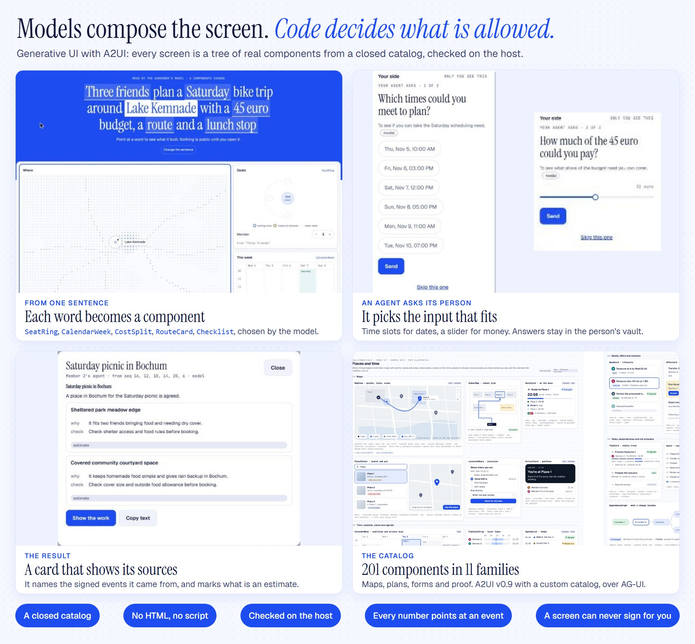

# Generative UI and the closed catalog

Screens are generated, but only from a fixed set of parts. A model chooses components from [the catalog](../reference/catalog/index.md) and fills them in. It cannot write HTML, script or styles.

## Why it is closed

A generated screen is a place where a mistaken or tricked model could show something false or dangerous. So:

- A tree naming an unknown component is refused. Raw HTML is forbidden.
- The host validates every tree before it reaches a browser. If one fails, a fixed layout is used, or plain words.
- A number on screen is bound as `{value, event_ref}`, pointing at the event it came from.
- A tree can never answer a consent. Only the trusted consent path can.

## The parts

The catalog has 201 components in 11 families, from text and forms to plans, maps and proof. It is [A2UI v0.9](https://a2ui.org) with a custom catalog, streamed to the browser over [AG-UI](https://docs.ag-ui.com).

A [Discipline Pack](../guides/packs/index.md) can add views of its own, through its pack catalog.

## Today in the room

The room's result layouts use seven of these: `Column`, `Row`, `Card`, `Heading`, `Text`, `Badge` and `Divider`. Questions use input components such as `ChoicePicker` and `Slider`. The forming screen picks from a wider set, such as a map and a calendar. The rest of the catalog is available to anything that composes a surface, and you can see all of it at `/gallery` on a running host.
