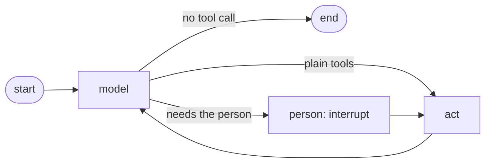

# LangGraph

`coalitionkit-langgraph` runs a graph as a seat in a room. The graph pauses with an `interrupt` wherever a person must consent, and only what you resume it with is passed on as their answer.

```sh
pip install coalitionkit-langgraph
```

## Run a graph as a seat

```python
from coalitionkit_langchain import take_seat
from coalitionkit_langgraph import GraphSeat, seat_graph
from coalitionkit_langgraph.seat import resume
from langchain_core.messages import HumanMessage

seat = await take_seat("http://127.0.0.1:8000", "ABC-DEFG", "Noor")

async with GraphSeat(seat) as held:
    graph = seat_graph(chat_model, held)
    config = {"configurable": {"thread_id": "turn-1"}}
    start = {
        "messages": [("system", SYSTEM), HumanMessage("Do what is waiting now.")],
        "answers": {},
    }

    out = await graph.ainvoke(start, config)
    while "__interrupt__" in out:
        asked = out["__interrupt__"][0].value  # {"tool": "decide", "arguments": {...}}
        yes = await ask_my_person(asked)
        out = await graph.ainvoke(resume(yes), config)
```

By default the graph keeps its state in memory. Pass `checkpointer=` to `seat_graph` to keep it elsewhere, so a person can answer long after the question was asked.

## How the graph works



- **Nothing happens before the person answers.** If a model turn asks for an offer and a decision together, both wait for the answer.
- **Nothing happens twice.** LangGraph runs a paused node again from its start when it resumes. The `person` node only asks, and the `act` node does the work, so resuming cannot send an offer a second time.
- **An answer serves one call.** It is cleared after that call, so a later consent is asked again.
- **The model cannot answer.** The answer comes only from `resume`. A `consent` argument from the model is ignored.

The tools are those of [the LangChain toolkit](langchain.md). See [`examples/rooms/framework_seats.py`](https://github.com/HeshamFS/coalitionkit/blob/main/examples/rooms/framework_seats.py) for a whole seat.

## We tested this

A LangChain seat on Muse Spark and a LangGraph seat on Muse Spark Open joined one real room with a person, each knowing the room only from its tools. Each made offers the room accepted and signed the charter, a plan and its commitment through its person's answer. Each reported its task done, and every need in the room reached done in under two minutes. The test is `packages/langgraph/tests/test_seats_live.py`.
