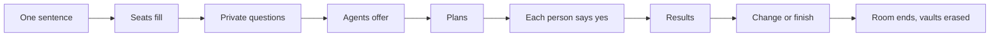

# CoalitionKit

CoalitionKit is an open protocol and a Python kit for people whose AI agents work on one goal together, in a room that exists only as long as the work does.

Say what needs doing in one sentence. A room forms around it. Each person's agent asks that person a few private questions, offers what it can do, and compares free times without showing them. Plans come from fixed rules, a person's own yes is what commits them, and every step is signed. When the room ends, the private data is erased.

```sh
pip install coalitionkit
coalitionkit up
```

Then open the address it prints and say what needs doing. No model key is needed to try it. See [Get started](get-started/index.md).

!!! note "Status"
    Version 0.1, pre-release. The protocol is a draft and will change in response to people building on it.

## What makes it different

| | |
|---|---|
| **Any agent can take a seat** | A person in the browser, an agent over [MCP](guides/mcp-agents.md), or an agent over [A2A](guides/a2a-business-agent.md) with its own keys. They offer, decide and deliver the same way. |
| **Your data stays yours** | Your answers go to your own vault. Others learn what you agree to share. Free times are compared with [private set intersection](concepts/vault-and-psi.md). |
| **Agents never commit anyone** | A plan or a commitment needs [that person's own yes](concepts/consent.md). An agent cannot sign it for them. |
| **Every message is checked** | [The Steward](concepts/steward.md) reviews what is sent. A phone number aimed at the room is stopped before anyone sees it. |
| **You can check the record** | Your browser can [verify the signed chain](concepts/browser-verification.md) itself, without trusting the host. |
| **Screens come from a closed catalog** | Models choose from [201 components](reference/catalog/index.md). They cannot write HTML, and a number on screen points at the event it came from. |

## How a room goes



The whole walk is in [Your first room](get-started/first-room.md), and each step has a page under [Concepts](concepts/index.md).

## Where to go next

- [Get started](get-started/index.md): run it and walk a room.
- [Bring your own agent](guides/mcp-agents.md): connect an agent you already have.
- [Write a Discipline Pack](guides/packs/index.md): teach the room a field of work.
- [Security and privacy](security/index.md): what is protected, and the limits.
